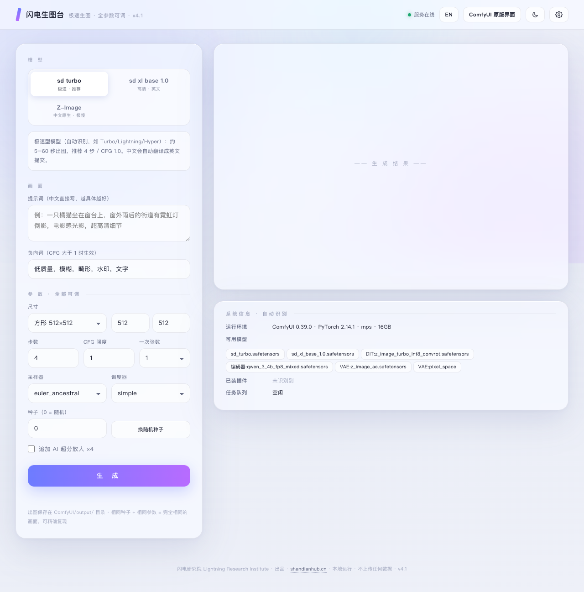
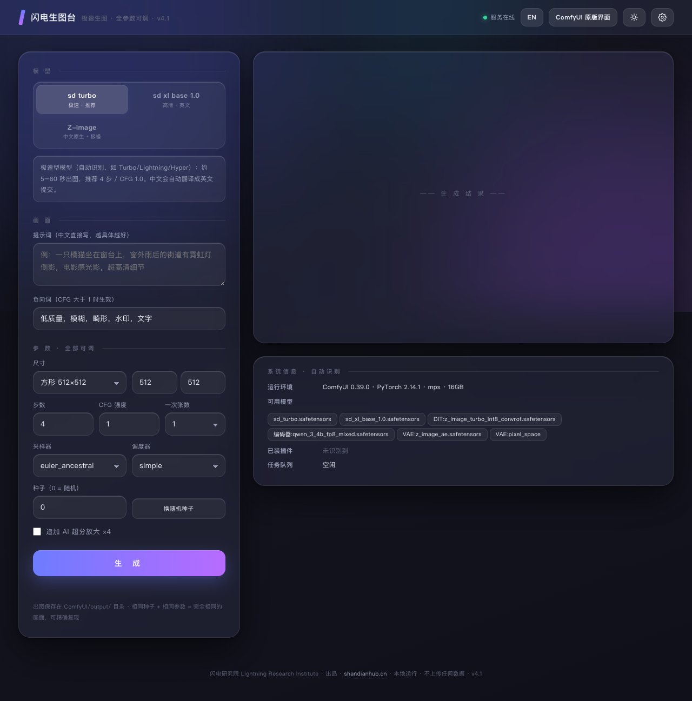
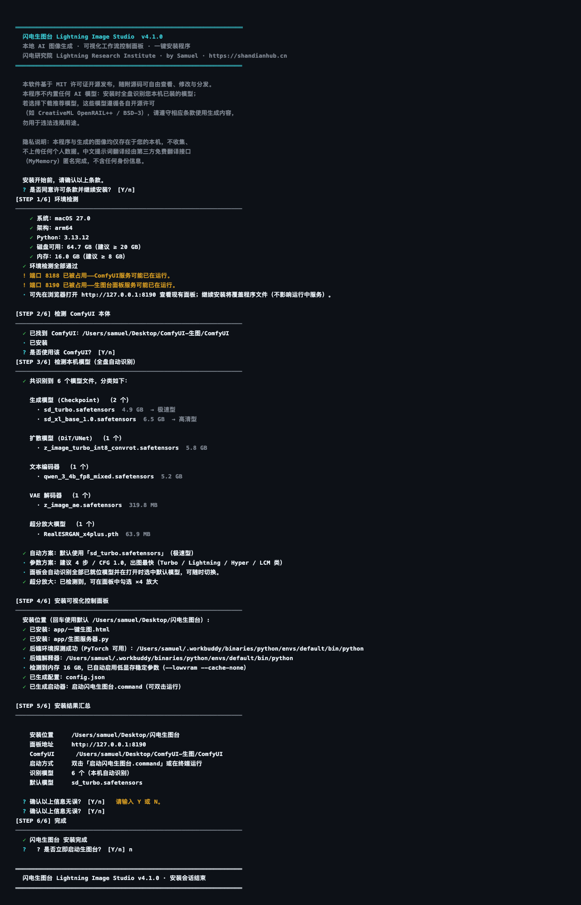
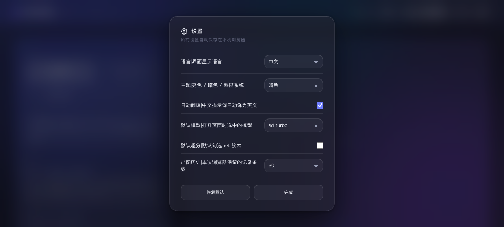
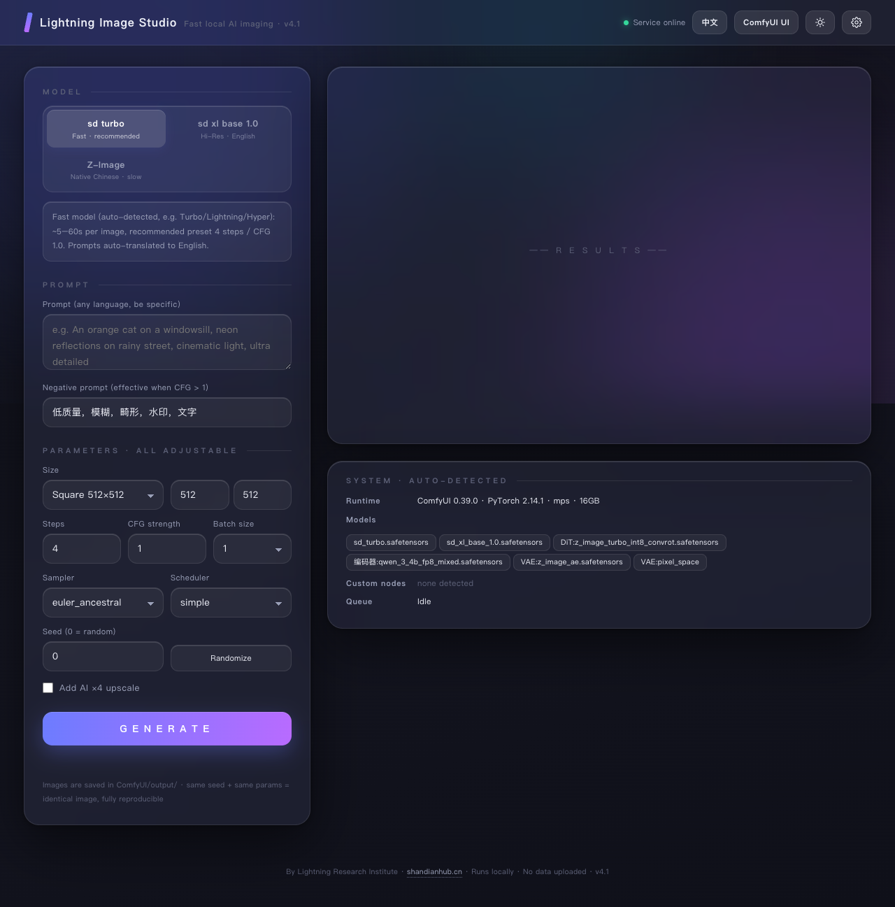

# ⚡ 闪电生图台 Lightning Image Studio

**本地 AI 图像生成 · 可视化控制面板 · 一键安装 · 完全免费开源**

[English](README_EN.md) · 官网：[shandianhub.cn](https://shandianhub.cn) · 出品：闪电研究院 Lightning Research Institute · by Samuel

---

一个部署在本机 [ComfyUI](https://github.com/comfyanonymous/ComfyUI) 之上的可视化控制面板。不懂节点、不用连线，中文描述直接出图；同时保留一键跳转 ComfyUI 原版工作流界面的入口。

## 🖼 界面预览

**主界面（亮色 / 暗色，一键切换）** —— 左侧全参数控制台，右侧生成结果与出图历史：

| 亮色 | 暗色 |
|---|---|
|  |  |

**终端一键安装器** —— 正式交互流程：许可确认 → 环境检测 → 自动识别，全程 Y/N 确认，每一步都告诉你它在做什么：



**系统信息 · 自动识别** —— 打开页面即自动扫描并列出：ComfyUI 版本、PyTorch 环境、显卡/内存、**本机全部可用模型**、**已装插件**、当前队列状态，零配置：


**设置中心** —— 语言、主题、自动翻译、默认模型、默认超分、历史记录条数，全部可设置、全部本机记忆：

| 设置中心 | 英文界面 |
|---|---|
|  |  |

## ✨ 特性

- **一键安装**：终端交互式安装器（Y/N 确认），自动检测环境、自动识别本机 ComfyUI 与模型，缺失模型可自动下载（国内镜像）
- **中文直出**：内置自动翻译，中文提示词自动转为英文提交（可关闭）
- **全参数可调**：尺寸 / 步数 / CFG / 采样器 / 调度器 / 种子 / 批量 / 超分放大
- **自动识别**：启动即扫描本机模型清单、已装插件、运行环境与队列状态，直接展示在面板上
- **中英双语**：界面一键切换中文 / English
- **亮暗主题**：亮色 / 暗色 / 跟随系统
- **设置中心**：语言、主题、翻译、默认模型、默认超分、历史记录条数，全部本地记忆
- **隐私优先**：完全本地运行，不上传任何图像与个人数据

## 🚀 快速开始

```bash
git clone https://github.com/sumuellovingjesus-hub/lightning-image-studio.git
cd lightning-image-studio
python3 install.py
```

或下载仓库 zip 后直接双击运行（macOS）：

```
安装闪电生图台.command
```

安装器会引导你完成：环境检测 → ComfyUI 识别（未安装可自动全新安装）→ 模型识别与补全 → 面板安装 → 启动。全程只需按 `Y` / `N`：

1. **许可确认** —— MIT 开源许可 + 隐私说明（本地运行、不收集数据）
2. **环境检测** —— 系统 / Python / 磁盘 / 内存逐项检查，不达标会明确警告
3. **识别 ComfyUI** —— 自动扫描常见安装位置 + Spotlight 搜索；找不到时可手动指定路径，或让安装器自动全新安装（克隆源码 → 虚拟环境 → PyTorch，国内镜像加速）
4. **识别模型** —— 自动列出已就位模型（含体积），缺失的逐个询问是否下载（ModelScope 镜像 + 多源回退 + 进度条 + SHA-256 记录）
5. **安装面板** —— 自动探测带 PyTorch 的 Python 作后端；小内存机器自动启用低显存参数；生成配置与启动器
6. **汇总确认 → 完成** —— 展示全部安装结果，可选立即启动

日常使用：双击生成的 `启动闪电生图台.command`，浏览器自动打开 `http://127.0.0.1:8190`。

## 🖥 系统要求

| 项目 | 最低 | 推荐 |
|------|------|------|
| 系统 | macOS 13+ / Linux | macOS 14+（Apple Silicon 实测流畅） |
| Python | 3.10 | 3.10 – 3.12 |
| 内存 | 8 GB | 16 GB+ |
| 磁盘 | 20 GB（含模型） | 30 GB |
| 网络 | 仅安装和下载模型时需要，生成阶段可离线 | — |

> 16 GB 及以下内存自动启用低显存稳定参数（`--lowvram --cache-none`）。

## 📦 模型：零内置，全盘自动识别

本程序**不内置、不捆绑任何模型**。安装与运行时自动扫描本机 ComfyUI 的 `models/` 全部目录，检测到什么就支持什么，并按文件名自动分类匹配参数方案：

| 自动识别的类型 | 自动匹配的参数方案 | 速度参考（16GB M4 实测） |
|------|------|------|
| 极速型（Turbo / Lightning / Hyper / LCM 类） | 4 步 / CFG 1.0 | 5–60 秒/张 |
| 高清型（SDXL 类） | 25 步 / CFG 7，原生 1024px | 5–15 分钟/张 |
| 经典型（SD 1.5 类） | 20 步 / CFG 7，原生 512–768px | 数十秒–数分钟 |
| 通用型（未识别） | 20 步 / CFG 6.5，可自行微调 | 视模型而定 |
| Z-Image（DiT + 千问编码器，中文原生） | 8 步 / CFG 1.0 | 约 90 分钟/张（16GB 不推荐） |

- 本机检测到什么模型，面板就显示什么按钮；默认自动选用极速型
- 超分放大模型（如 RealESRGAN ×4）同样自动识别，检测到才显示 ×4 选项
- 本机没有任何模型时，安装器提供**完全可选**的推荐清单（带开源许可说明），也可跳过后自行放入 `models/checkpoints/`

## 📁 仓库结构

```
lightning-image-studio/
├── install.py               一键安装器（纯 Python 标准库）
├── app/
│   ├── 一键生图.html         可视化控制面板（i18n / 设置中心 / 自动识别）
│   └── 生图服务器.py         本地中转服务器（system-info API / 队列保护）
├── docs/                    安装指南 · 使用教程 · 常见问题
├── LICENSE                  MIT
└── SECURITY.md              安全策略
```

## 📖 文档

- [安装指南](docs/安装指南.md)
- [使用教程](docs/使用教程.md)
- [常见问题](docs/常见问题.md)

## 🤝 参与贡献

欢迎 Issue 与 PR。提交前请运行 `python3 install.py` 完整走一遍安装流程确认无回归。

## 📄 许可

本仓库代码基于 [MIT License](LICENSE) 开源。本程序不捆绑任何模型；若您选择下载推荐模型，这些模型遵循各自原始许可（OpenRAIL++ / BSD-3 等），请合规使用生成内容。

---

闪电研究院 Lightning Research Institute · [shandianhub.cn](https://shandianhub.cn)
